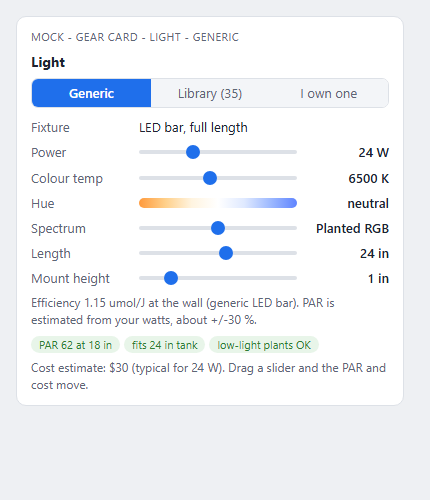
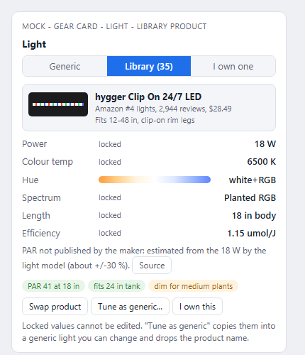

# Gear model: generic pieces plus a locked product library (design note)

Status: DESIGN ONLY, nothing coded. Written 2026-10-29 off origin/main (d235e0d8). Amended same day for Nathan's ruling: brands do not matter for minor
gear ("I dont really care what brand your thermometer is"), so each type has a CLASS (section 2a): `library` (generic + real products) or `generic` (one tunable item, no catalogue).
Ask (Nathan): "a generic version of every piece of equipment, with tunable stats (wattage for a light, flow for a filter, etc), but also a
library of actual products (ideally a large share of the most popular of each type) with non-editable attributes like wattage, light hue, flow."

## 1. What exists today (audit)

The library tier is mostly built. The generic tier is the weak half, and the two are not joined by one schema.

| Type | Library (`src/data/gear-catalog.json`) | Generic today | Drawn |
|---|---|---|---|
| Light | 35 (`lights`: 16 bar, 10 hanging, 4 submersible, 3 gooseneck, 2 rim-legs) | `FIXTURES` + `TECHS` in `scene/lightout.ts` (7 lamp types, ppe 1.15-1.8 umol/J), tunables in the light panel (`ui/panels.ts`: count, watts, kelvin, height, cone) | `render/light3d.ts` / `lighting.ts`, product body + LED dots from `LightLook` |
| Heater | 40, with part-by-part `HeaterLook` | `HeaterUnit.w` (any watts) + `HEATER_SIZES` + `genericHeaterW` in `data/gearCatalog.ts`; `gear-models.json` heaters (price rows) | `render/gear3d.ts` (length from watts) |
| Filter | 79 (38 hob, 16 internal, 14 canister, 11 sponge) | `gear-models.json` 8-ish generic models by kind (`demand/gear.ts` `matchFilter`), step up/down by model id | `gear3d.ts`, `FilterLook` |
| Pump | 34 (18 air, 14 powerhead, 2 wavemaker) | none (count only, `TechOption.count`) | `gear3d.ts` |
| Skimmer, UV, CO2, ATO, chiller | 12 / 9 / 8 / 6 / 7, many with `needSpec` gaps | none; priced from `tech.json` `gear` rows | `gear3d.ts`, colours often estimated |
| Everything else in `tech.json` `gear` (44 parts) | none | priced and powered by `GearDef` only | simple `gear3d.ts` shapes |
| The five `equip` items (`scene/equipment.ts`, `render/equipment.ts`) | none | each is a hand-placed Items-panel piece (heater, HOB, lily pipe, mister, light bar), off behind `EQUIP_ENABLED = false` since 2026-10-16 | lathe/rounded-box shapes, no product colours |

Key findings:

1. **The five equip pieces duplicate `gear3d.ts`.** Heaters, filters and lights are already drawn from the Tech menu by product or by size. The equip items are a second, hand-placed path with no stats, no price, no physics. They should be retired, and their best geometry (the lily-pipe lathe, the mister nozzles) folded into generic models. Only the lily pipe and mister line have no other drawing (lily pipes: not in the catalog at all).
2. **Gear lives in the Tech menu (`ui/techMenu.ts`), not in the Items panel.** The Items panel (`scene/items.ts` `KINDS`) holds stones, wood, caves, plants, corals. Lights are edited in the light section of `ui/panels.ts`; the catalogued light is picked in the Tech menu. So "Items panel with sliders" means a new gear card, shown in the Tech menu row (and linked from the light panel), see section 5.
3. **Each type has its own product interface** (`HeaterProduct`, `FilterProduct`, `LightProduct`, `PumpProduct`, `GearListing` subtypes) and its own ad-hoc generic (heater `w`, filter `model`, light settings). Physics reads whichever it was written against, so a new type means new plumbing.
4. **One JSON file (10.8k lines) holds every type.** Parallel lanes adding products would conflict on it.
5. **Pricing**: a product with a real `priceUsd` is priced at it (+-10 %, `demand/engine.ts`); a generic uses `gear-models.json` / `tech.json` price rows scaled by size. Owned gear: the plan sheet and cost lines already show owned items as $0 "you have" (`demand/buildplan.ts`, `costlines.ts`), but I found no per-unit "I own this" flag on gear; `kit: true` on a heater/filter unit marks gear that came in a bundle. Ownership needs a field.
6. **Welfare and budget** read computed stats: heater watts vs `heatLoss` (`scene/tech.ts`), pump/filter gph vs turnover (`pumpTurnover`, `flowTierCap` in `scene/tech.ts`), light PAR from `lightout.ts` and `lightcheck.ts`. These are the physics to keep unchanged.

## 2. Data model

One record shape for both tiers. A **StatBlock** per equipment type is the only thing physics ever sees.

```ts
const CLASS: Record<GearType, 'library' | 'generic'> = { light: 'library', heater: 'library', /* ... table 2a */ mister: 'generic', /* ... */ };
type GearType = 'light' | 'heater' | 'filter' | 'powerhead' | 'wavemaker' | 'airpump' | 'skimmer' | 'uv' | 'co2' | 'ato'
  | 'chiller' | 'thermostat' | 'timer' | 'controller' | 'mister' | 'fogger' | 'uvb' | 'heatlamp' | 'heatmat' | 'lilypipe' | 'lid' | ...;

// Tier 1 (generic): the user's own numbers, within hard limits per stat.
interface GenericGear<T extends GearType> { type: T; stats: StatBlock[T] }

// Tier 2 (library types only): identity + locked stats + look. A generic-only type has no ProductGear: just a default StatBlock,
// limits, a price curve and one simple model.
interface ProductGear<T extends GearType> {
  id: string; type: T; brand: string; model: string;
  stats: StatBlock[T];            // LOCKED: read-only in the UI
  dims: { w: number; d: number; h: number };   // mm
  priceUsd?: number; priceSeen?: string; url: string; asOf: string;
  est?: (keyof StatBlock[T])[];   // stats that are estimates, shown as such (exists today)
  popularity?: Popularity;        // exists today
  look: LookByType[T];            // per-part colours (exists today per type)
}

// What a scene stores (replaces HeaterUnit / FilterUnit / LightSettings.product as three slightly different things)
interface GearRef { type: GearType; product?: string; stats?: Partial<StatBlock>; owned?: boolean; paidUsd?: number }
// product set  -> stats come from the library (stats here ignored)
// product absent -> generic: stats here, missing ones default from the tank's need
```

`statsOf(ref): StatBlock` returns the product's locked stats or the generic's tuned ones. **Everything downstream calls `statsOf`**, so a product and a generic of equal stats give identical PAR, turnover, watts per gallon and welfare results (tested by one parameterised test per type: product vs generic copy of it, same outputs).

### 2a. Class per type (Nathan 2026-10-29)

Each type declares `class: 'library' | 'generic'`. A **library** type has the generic piece AND a product catalogue with locked stats. A **generic** type has ONE item with tunable stats, a default, a price curve and a simple model; no product records, no brand, no research. Test used: does choosing a particular product change welfare, the light/flow/heat numbers, or the cost line by more than the generic's tunables already capture?

| Type | Class | One-line reason |
|---|---|---|
| Light | library | PAR, spectrum and price vary hugely by product |
| Heater (aquarium) | library | watts and size drive the heat-holds gate; catalogue already there (40) |
| Filter (hob, canister, internal, sponge) | library | real gph and rated range drive turnover and capacity (79 done) |
| Powerhead / wavemaker | library | flow and wave mode set the reef flow tier (16 done) |
| Air pump | library | already catalogued (18), cheap to keep; low stakes |
| Skimmer | library | rated gal differs a lot from the label; sets the reef care tier |
| CO2 system | library | stages, cartridge vs cylinder change cost and dosing control |
| UV sterilizer | library | lamp watts vs flow decides whether it clears water |
| Chiller | library | cooling capacity (dF, hp) differs by product and decides a hot-tank pass/fail |
| ATO | library (borderline) | sensor count (1 or 2) changes flood risk in `tech.ts`; 6 done, keep small |
| Thermometer / hygrometer | generic | accuracy is not modelled; one item, price curve only |
| Thermostat / controller (heat or light) | generic | stats are channels and on-off vs dimming; brand adds nothing we model |
| Timer | generic | channels only |
| Heat lamp (dome / basking bulb) | generic | watts and beam decide basking temp; tunable watts covers it |
| Heat mat | generic | watts and size only |
| Mister, fogger | generic | nozzles and ml/h; brand adds nothing we model |
| Lily pipe / inflow-outflow | generic | outlet diameter and look only |
| Doser, auto feeder, RO/DI unit, drop checker | generic | priced and powered rows only (they already live as `tech.json` `gear`) |
| Return pump | generic (borderline) | gph and head set sump turnover, both tunable; no product changes more |
| Sump | generic | already modelled by size (`sumpFromModel`) |
| Lid / hood | generic | open %, material, hood-LED; feeds `heat.surface` evaporation term |
| UVB tube | generic (borderline, welfare) | see question 4: UVB output (5.0 / 10.0 / 12 %) is the welfare stat and is a tunable; real UVI by brand is not modelled |

Welfare-sensitive generic-only types (UVB, heat lamp, thermostat, lid) carry the welfare-relevant stat as a tunable with a safe default and the usual warn-not-block limits, so the gate still works without a catalogue.

### Stat schema per type (editable on generic; ALWAYS locked on a product). Units: stored metric, shown per scene units (US in chat: gal, in, deg F, W, gph).

| Type | Generic tunables (min..max) | Locked-only (product facts) | Derived (never edited) |
|---|---|---|---|
| Light | watts 3..400; kelvin (by lamp family); hue / spectrum preset (white, planted RGB, reef blue, custom RGB split); length in; mount height in; beam angle (spot) | efficiency umol/J at the wall (generic LED bar = 1.15, `lightout` audit), published PAR, controller, dims, brand | PAR map, 24/7 schedule fit, light-fit verdicts |
| Heater | watts 25..500; length follows watts; preset vs adjustable thermostat | rated gal range, accuracy, shroud/titanium, dims | watts per gallon vs `heatLoss`, holds target Y/N |
| Filter (hob / canister / internal / sponge) | gph 20..1500; kind; media volume (qt) | rated gal range, watts, intake length, dims | turnover per hour, biological capacity |
| Powerhead / wavemaker | gph 100..5000; watts; wave mode Y/N | controller, dims | reef flow tier (`REEF_FLOW_X`) |
| Air pump | air gph; outlets | dB, depth rating | bubble rate to stones |
| Skimmer | rated gal; gph air | watts, dims, hob/sump | skim tier |
| UV | watts of lamp; rated gal | bulb hours | clarifier verdict |
| CO2 | bubbles per second or ppm target; cylinder size (generic regulator) | stages, cartridge g, days | drop-checker colour |
| ATO | sensors 1 or 2; reservoir gal | pump | failure risk (`tech.ts`) |
| Thermostat / controller / timer | channels; on-off vs dimming | brand display | dry-tank temp control (`tech.json` `thermostat`) |
| Mister / fogger | nozzles; l/h or ml/h; interval | brand, reservoir | humidity gain |
| UVB / heat lamp / mat | watts; UVB % (T5 HO 5.0 / 10.0); lamp length | brand, UVI at distance if published | UVI at basking distance |
| Lily pipe | outlet diameter in; flow shown | brand, glass vs acrylic | surface agitation note |
| Lid / hood | open %, material (glass, mesh), hood-LED Y/N | maker size | evaporation and `heatLoss` surface term (already in `tech.json` `heat.surface`) |

Hard limits stop absurd values but only warn, never block (a 500 W heater in a 5 gal tank gets the welfare warning, same as a library one would).

The stat table below applies to both classes; the "locked-only" column is meaningful only for library types.

### Where it lives
- Split `gear-catalog.json` into `src/data/gear/<type>.json` (one file per type) plus `src/data/gear/index.ts` that merges them, so lanes add products without touching the same file. Existing lookups (`lightProduct`, `heaterProduct`, ...) stay as thin wrappers: no caller changes.
- New `src/scene/gearSpec.ts`: `StatBlock`, `statsOf`, per-type limits and defaults, adapters from old fields (`HeaterUnit.w`, `FilterUnit.model`, `LightSettings.watts/product`) so saved files keep loading with no version bump.
- `scene/lightproduct.ts` `applyLightProduct` becomes the light adapter into `LightSettings` (it already does what `statsOf` needs).

## 3. How a product maps onto a generic

A product is a generic whose stats are frozen plus identity and look.

- `statsOf(product)` returns `product.stats`; the physics code path is the generic path with those numbers (for lights `applyLightProduct` already writes watts, tech, kelvin, PAR override into `LightSettings`, which is exactly this).
- **Swap**: product A to product B replaces `product`; generic to product keeps nothing but the type; product to generic **copies the stats in** ("Tune as generic...") so the owner can nudge a real product's numbers and see the effect, with the product name dropped.
- **Estimates**: `est` marks stats the maker does not publish (most light PARs). The UI shows "estimated by the model" next to those, as the light picker does today.
- **Tests**: per type, `statsOf(product)` fed through the physics equals `statsOf(genericCopy(product))`.

## 4. Picking, swap, "I own this", pricing

- **Picking**: the card has three tabs: Generic | Library | I own one. Library lists products near the size the tank needs first (exists: `heatersNear`, `filtersNear`, `lightsFor`, `pumpsFor`), with price and the "popular" evidence line.
- **Swap menu** (`demand/swaps.ts` exists): shows each alternative's stat deltas, price delta and welfare effect (e.g. "+40 gph turnover, +$12, +3 W").
- **I own this**: sets `owned: true` and optionally `paidUsd`. Cost lines show $0 "you have" (existing layer logic), electricity and welfare still count, and the plan sheet lists it under "Already have". An owned piece can be a library product, a generic, or a "my own: [free-text name] + stats" generic.
- **Pricing, generic-only types**: one price curve per type from the existing `tech.json` `gear` price rows (watts, ml/h or nozzles as the driver); no per-product price. Cost accuracy risk: where those rows are thin (UVB, heat lamp), the curve carries the usual range; if Nathan wants better, add 3-5 anchor prices to the curve, not a catalogue.
- **Pricing, library types**: product = `priceUsd` (listed, one retailer, one day, +-10 %, existing); generic = price curve per stat (watts or gph) fitted from the library's own prices of that type, replacing the hand-set `gear-models.json` price rows over time; both reach the budget ceiling via the existing `demandOf`. Welfare is a gate: a cheaper pick is only offered if its `statsOf` passes the welfare check.

## 5. Screens (mocks, illustrative numbers)

Generic light, sliders tunable:



Same light picked from the library, stats locked, with "Tune as generic..." and "I own this":



Placement: one **gear card** component (`ui/gearCard.ts`, new) used for every type, shown inside the Tech menu row (Heating, Filtration, Lighting, Flow, ...) where products are picked today. The light panel keeps its fixture controls and gains a link to the card.

## 6. Equipment types missing today

Library types present: light, heater, filter, air pump, powerhead, wavemaker, skimmer, UV, CO2 (partial), ATO, chiller. Nothing is missing there beyond gaps (section 7).

Generic-only types still to define (no library, one item each): thermometer / hygrometer, thermostat and light controller, timer, heat lamp, heat mat, mister, fogger, lily pipe, doser, auto feeder, RO/DI, drop checker, return pump, lid / hood, UVB tube. Most already exist as a priced and powered row in `tech.json` `gear`; the work is a stat block with limits, a default and one simple model, not data research. Lids have a model in `demand/lid.ts`; sumps in `sumpFromModel`.

## 7. Ranked library plan (top products per type)

Popularity sources already collected in `research/gear-popular/` (Amazon US Best Sellers + product pages, read 2026-10-20 and 2026-10-27, ratings and bought-per-month recorded per product): `lights.md`, `filters.md`, `heaters.md`, `pumps.md`, `reef-planted.md`. Rule kept: a spec the product page does not state is not entered (listed as `needSpec`).

| Type | Have | Target (share of what is bought) | What to add, in order |
|---|---|---|---|
| Light (freshwater) | 35 | top 25 by Amazon rank | close `est` gaps; add the planted names a hobbyist asks for: Fluval Plant 3.0, Finnex Planted+ 24/7, Chihiros WRGB II, Current USA Orbit (candidates, read page before entry) |
| Light (reef) | 10 hanging + Kessil | top 12 | Kessil A80 and Tuna lights exist; AI Prime 16 HD, Radion XR15 (candidates, `needSpec` for PAR) |
| Heater | 40 | top 20 | hygger, Aqueon Pro, Fluval E, Eheim Jager, Cobalt Neo-Therm, Top Fin: mostly in; fill 100 W / 200 W / 300 W sizes |
| Filter | 79 | top 40 | in already; add sumps' return pumps |
| Powerhead / wavemaker | 16 | top 15 | Jebao, Hydor Koralia, Tunze, Maxspect Gyre (candidates) |
| Air pump | 18 | done | |
| Skimmer, UV, CO2, ATO, chiller | 42 | top 8 each | close the `needSpec` fields (watts, size, flow) from product pages |
| Generic-only types (thermostat, mister, fogger, UVB, heat lamp, lily pipe, ...) | n/a | n/a | **No product research.** Default stats and a price curve only. |

"Candidates" = brand/product names I expect to be popular from general knowledge, to be confirmed on an Amazon / maker page before entry; the lane records the evidence line like the existing rows. Primary popularity source going forward: Amazon US Best Sellers + "bought in past month", cross-checked against Chewy and PetSmart rankings (both already used for heater prices).

## 8. Rendering

- **Generic**: one simple, crisp neutral model per type, scaled by the tunables (a heater whose length follows watts exists; a bar whose length follows the length slider; a canister body whose size follows gph). Reuse the best of `render/equipment.ts` (lathe lily pipe, mister nozzles) and the existing `gear3d.ts` shapes; neutral grey/white, matching the real tank render (not cartoony, per Nathan).
- **Product**: the same builder fed that product's per-part colours (`HeaterLook`, `FilterLook`, `LightLook`, pump/other `colors`), its own `dims`. Geometry may be simple; colours must be true. Variants beyond colour (a different body shape) are rare; add a `shape` key on `look` (already done for heaters: `tube` / `flat`).
- `render/gear3d.ts` (1053 lines) is split per type (`render/gear/heater.ts`, `filter.ts`, `light.ts`, ...) so lanes do not touch the same file; its public functions keep their names.
- Generic-only types need one simple model each (heat lamp dome, mist nozzle line, lily pipe, thermostat box, lid), neutral colours, scaled by the tunables; no per-product variants.
- Retire `render/equipment.ts` + `scene/equipment.ts` and the `equip` kind once the lily-pipe / mister pieces live in the new per-type builders (saved `equip` items load as plain objects until then).

## 9. Build order (lanes; each owns its files)

| Lane | Work | Files it touches | Needs |
|---|---|---|---|
| G0 foundation | `gearSpec.ts` (StatBlock, `statsOf`, limits, adapters); split the catalog JSON per type; parity tests | `src/scene/gearSpec.ts`, `src/data/gear/*`, `src/data/gearCatalog.ts` (wrappers) | design sign-off |
| G1 gear card UI | `ui/gearCard.ts` (generic sliders / library / I own); wire to Heating first, then Filtration, Lighting; unit display US + metric | `src/ui/gearCard.ts`, `src/ui/techMenu.ts`, `src/style.css` | G0 |
| G2 ownership + pricing | `owned` / `paidUsd` on `GearRef`; price curves from library; swap deltas; plan sheet and cost lines | `src/demand/*`, `src/scene/setupsheet.ts` | G0 |
| G3 generic render + split gear3d | per-type builders, generic models, retire equipment items | `src/render/gear/*`, `src/render/gear3d.ts`, `src/scene/equipment.ts` | G0 |
| G4a library: lights | close est gaps, add planted + reef names | `src/data/gear/lights.json`, `src/scene/lightproduct.ts` | G0 |
| G4b library: heaters, filters, pumps | add sizes / brands | `src/data/gear/{heaters,filters,pumps}.json` | G0 |
| G4c library: reef gear | close `needSpec` on skimmer, UV, CO2, ATO, chiller | `src/data/gear/{skimmers,uv,co2,ato,chillers}.json` | G0 |
| G5 generic-only types | stat block, limits, default, price curve and one simple model per type (thermostat, mister, fogger, UVB, heat lamp, heat mat, lily pipe, doser, lid, ...); no catalogue | `src/scene/gearSpec.ts` (type entries), `tech.json` rows, `src/render/gear/*` | G0, G3 |

G4a-c are small (data gaps only) and run in parallel after G0 (distinct JSON files); G4b and G4c could merge into one lane. G1 and G2 run in parallel after G0 (UI vs demand). G3 after G0, parallel to G1/G2. G5 last.

## 10. Questions for Nathan (max 4)

1. **Where should the card live?** A gear card inside each Tech-menu row (Heating, Filtration, Lighting...) with three tabs Generic | Library | I own one, as in the two pictures above (generic sliders; locked library stats). The Items panel keeps decor only (stones, wood, plants). Yes, or do you want gear in the Items panel?
2. **Locked stats escape hatch.** On a library product the stats are read-only, with a "Tune as generic..." button that copies them into an editable generic light (picture 2, bottom). Keep that button, or strictly no editing of a product?
3. **Library breadth.** Library types only (lights, heaters, filters, pumps, skimmers, CO2, UV, chillers, ATO): a product is entered only when its page states the spec (the rest marked "estimated" or left out), target about 20-40 popular per type, ranked by Amazon "bought in past month", cross-checked with Chewy and PetSmart. OK, or may estimates fill gaps?
4. **UVB tubes: generic-only OK?** UVB output is a welfare stat for reptiles. Plan: one UVB tube item with a tunable strength (5.0 / 10.0 / 12 %), length and distance, no brands; real UVI by brand is not modelled. Fine, or should UVB tubes (and heat lamps) get a small product library?

Retiring the five old equipment items needs no question now: with the class rule they become the generic models (the heater is library-class and already drawn by `gear3d.ts`), so I treat the retirement as decided unless Nathan objects.
