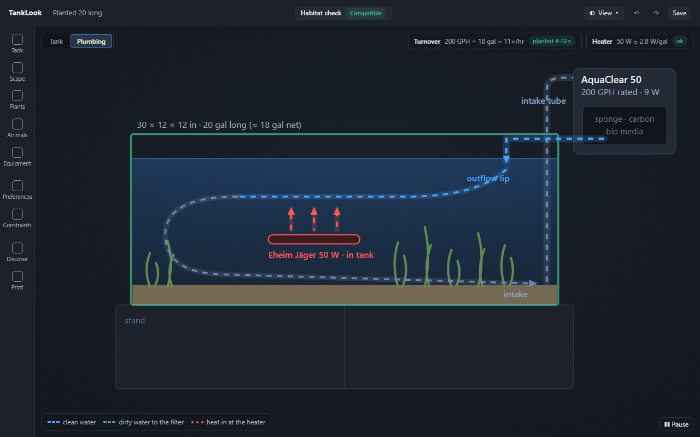
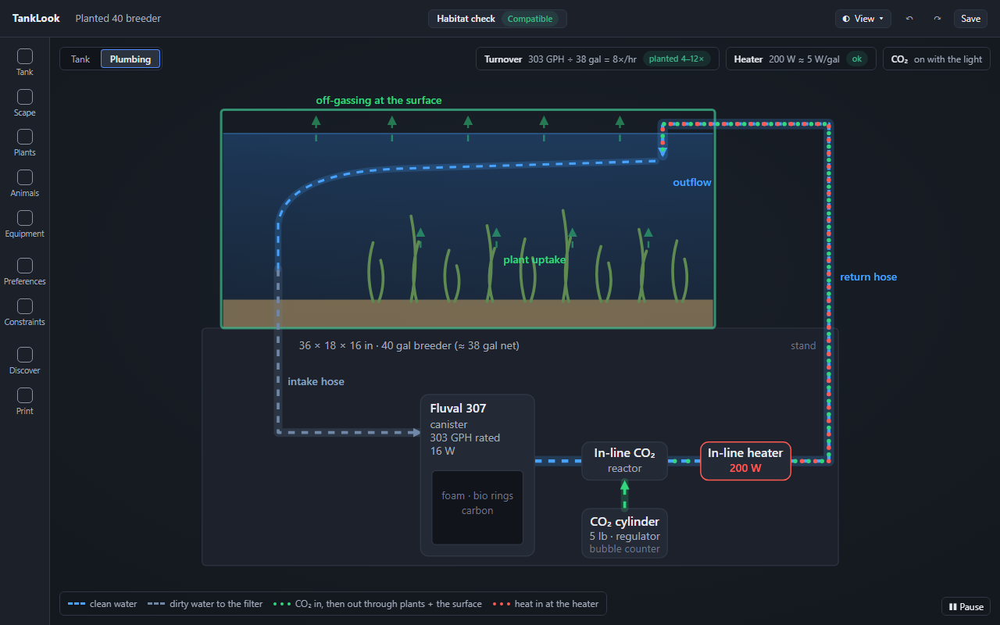
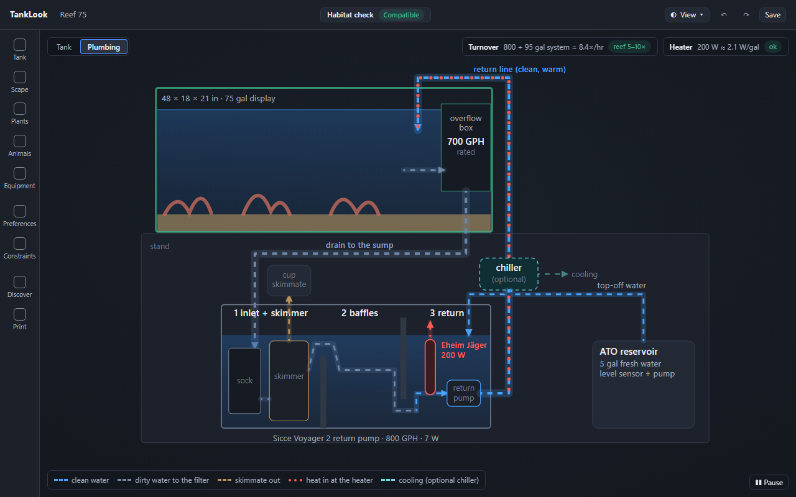
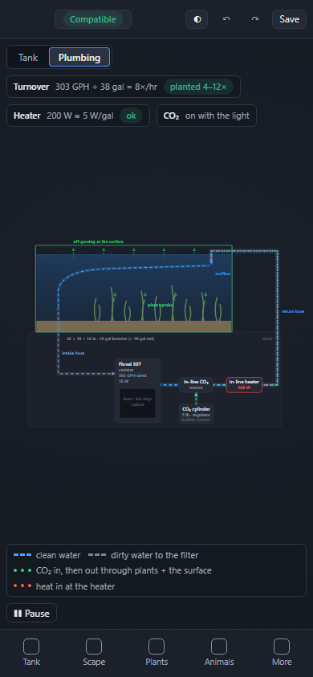
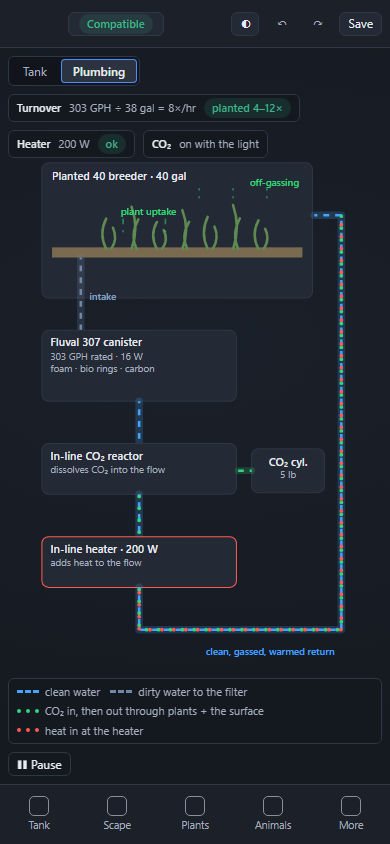
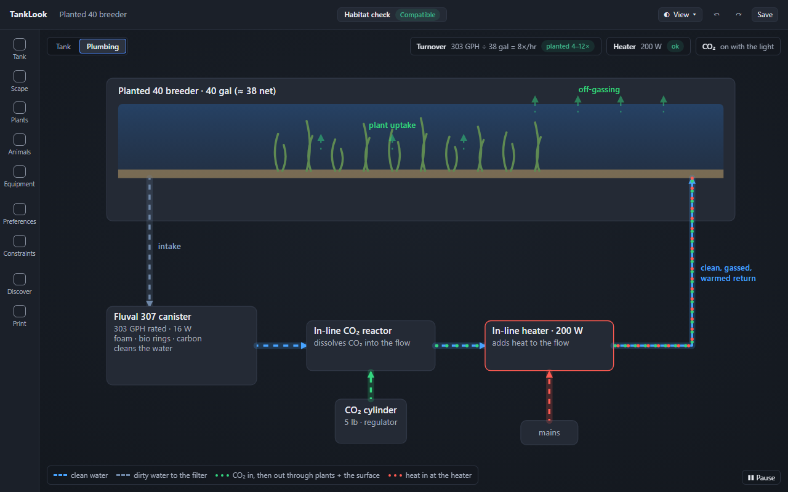

# PV1: Plumbing view mockups (R100)

Open the `.html` files in a browser (self-contained). Mockups only; nothing in `src/` changes. `build.mjs` generates the HTML, `shoot.sh` makes the PNGs (headless Chrome).

## Nathan's decisions (2026-11-16)
1. **Side cutaway** is the layout for the build (not flat). Flat (`02b`) stays here only as a reference.
2. **No heat-loss arrows, no toggle.** Removed from every mockup. Heat is shown only as heat entering at the heater.
3. **Where the Plumbing switch lives** ("rec" = take my recommendation): keep the Tank | Plumbing segmented control at the top left of the viewer, as drawn. It is where the eye already is, it is one click, and it doesn't use a rail slot or bury it in the View menu.
4. **Chiller:** fine, keep it as the optional cyan box.
5. **Flow numbers:** just "rated". No real-flow estimate.
6. **Return-vs-overflow badge:** not needed. Dropped from mockup 3; the overflow box still states its rated GPH.

Still open for the build, not asked: the cutaway is unreadable at 390 px (see the phone pair). Phone needs its own answer: the flat portrait drawing (`02b-canister-40-flat-390.png`) is available if wanted.

## Pictures
**1 HOB planted 20 long**

**2a Canister 40, side cutaway (the pick)**

**3 Reef 75**

**Phone, 390 px: cutaway (left) vs flat (right)**

 

**2b Flat (reference)**

## Legend
- Blue dashed, bright = clean water. Duller grey-blue = dirty water going to the filter.
- Green dots = CO2: joins at the reactor, rides the return; out through plant uptake (down into plants) and off-gassing (up at the surface).
- Red dots = heat: joins at the heater, rides the return.
- Amber-brown = skimmate. Cyan = cooling (optional chiller). Dashed outline = optional gear.
- Chips at the top: turnover (rated GPH / net gal), heater W/gal. Gear uses real catalogue names and numbers (AquaClear 50, Fluval 307, Eheim Jäger, Sicce Voyager 2). Net gallons are my estimates; the build would use the tank model.
- Pause button bottom right; `prefers-reduced-motion` starts paused.

## What I invented
- In-line CO2 reactor and in-line heater are generic boxes (200 W heater, 5 lb cylinder) until R99 / IL1 adds real gear.
- The app has no tab strip over the viewer today (the header has a View menu); the Tank | Plumbing control is a proposal.
