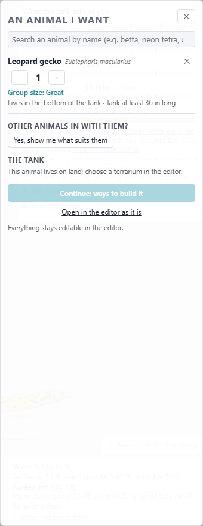
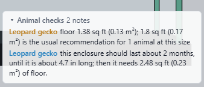
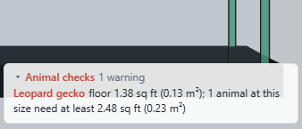
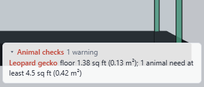
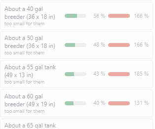
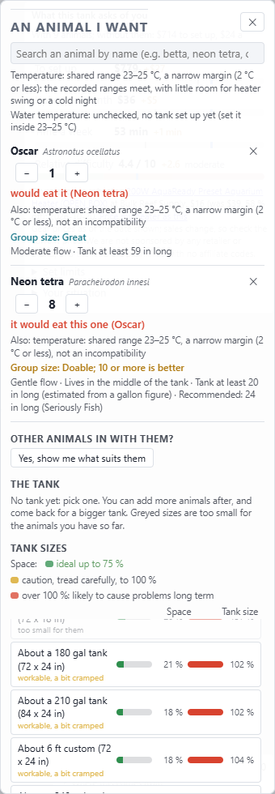

# Outgrows: "fine for now" for growing animals (design, 2026-10-26; branch `outgrows`; awaiting Nathan's yes)

Nathan (2026-10-26): a baby leopard gecko in a 10 gal is fine, but the app rejects it because it judges the adult (~9.8 in).
The app should say "fine for now, but in about X time or at Y length this stops working". This note covers what the app does
today (screenshots on main e544a63, build 1244), the design to confirm, and the open questions. Nothing is built yet.

## 1. What the app does today

**Stocking planner ("An animal I want"), leopard gecko.** The planner has no tank list for land animals at all. It shows the
adult rule ("Tank at least 36 in long") and says "This animal lives on land: choose a terrarium in the editor." So the
planner does not grey out a 10 gal for the gecko; it never offers one. Neither the planner nor its picks have any idea of size.

**Editor, the same gecko in a dry 10 gal (20 x 10 in, 1.38 sq ft), at each stage.** Only the editor's herp check
(scene/herpcheck.ts) reads the animal's own length. It already gives a "should last" line:

| Stage (length) | Animal checks | |
|---|---|---|
| hatchling (3.0 in) | note: 1.8 sq ft is the usual recommendation at this size; info: "this enclosure should last about 2 months, until it is about 4.7 in long; then it needs 2.48 sq ft of floor." |  |
| juvenile (5.4 in) | warning: needs at least 2.48 sq ft at this size |  |
| adult | warning: needs at least 4.5 sq ft |  |

The app's own curve says the 10 gal lasts about **2 months** (to 4.7 in), not 6. The brief's sample sentence used 6 months; the real
reading uses herpstock's curve: hatchling 80 mm at 0 months, 125 at 2, 150 at 6, 185 at 12, 220 at 18.

**Planner, oscar (and oscar + neons).** Fish get a tank list, judged at adult length (300 mm). Every size below 240 gal is greyed
("too small for them"); the 55 gal reads 185 % of the size it needs. The prey gate fires at once ("would eat it (Neon tetra)"),
whatever the oscar's size. (Seen in passing: the small tanks show "Infinity %" in the Tank size column. That's a separate fix.)

 

**What reads the current length today:** the herp check (stage floor and height, the "should last" loop) and the space engine
(stocking.ts already sizes each animal at `f.tl ?? sp.tl`). **What reads the adult only:** the tank minimum (tankMin.ts `whoOf`
takes `sp.tl`), the prey gate (animalfit.ts `preyRisk` compares the predator's adult `prey.mm` with the prey's adult `tl`), group
territory caps (groups.ts `mostFor`, by tank only), and the whole planner (`Pk` has no size).

## 2. Proposal (to confirm)

**(a) One growth model for every animal.** `lengthAt(sp, months)` and `ageAt(sp, mm)`:
- herps: keep herpstock's `grow` curves as they are;
- fish: von Bertalanffy, L(t) = Linf (1 - e^(-K (t - t0))), with **Linf = the app's adult length** (aquarium TL, so the curve ends where
  every other check already does) and **K from FishBase** where it publishes growth parameters for the species. Where it doesn't, a class
  default by adult size (small / medium / large), marked `est` in the line as the tank minimums mark derived numbers. FishBase K is mostly
  wild growth, so each sourced K gets one keeper sanity check. Example: oscars are usually quoted at about an inch a month when young.
  The table goes in a new `src/data/growth.json` with a source per row, as sources.json does;
- inverts, snails, corals: no curve (always adult), as today.

**(b) A pick carries a size.** The planner's pick row gets the editor's stage buttons (hatchling / juvenile / sub-adult / adult,
data/lifestages.ts), default **adult**, so nothing changes for anyone who doesn't touch it. Shares for fish (new): 0.15 / 0.35 / 0.7 / 1
of adult length (an oscar sold at about 2 in reads "hatchling"). The buttons only show for animals that grow enough to matter:
herps as today, fish with an adult length of 100 mm or more (question Q2). `Pk` gains `tl?`, which goes into the tank as `Fish.tl`, the
same field the editor, the scatter and calib-v4 use.

**(c) Every check runs at the current sizes, then steps forward along all the curves together.** One shared function
(generalising herpcheck's loop), `outgrows(S) -> { now: verdict, until?: { months, who, lengthMm, check, need } }`. Each step sets
every animal's `tl` to its length after that many months and re-runs the same checks the screen runs now. It stops at the first step
that fails, or when every animal is adult. The steps are monthly for the first 2 years, then quarterly. What each check reads at a
juvenile length:
- tank minimum: the red and green lines scale **linearly** with length share, the same rule the herp stages follow (a 0.3-length
  hatchling gecko needs 0.3 of the adult floor). Squared would be the geometric choice; linear is the conservative one (Q3);
- herp floor and height: the existing stages;
- space percent: already length-based;
- group territory and most-per-tank: unchanged while juvenile, because sources give these for adults and juveniles fight less. They are
  judged when the animal reaches the stage where the sources' adult behaviour starts (sub-adult);
- prey gate, both ways: the predator's gape scales with its length (`prey.mm x tl / adult tl`), and the prey is judged at its current
  `tl`. That covers a grown predator eating its tankmates as well as a small juvenile being eaten.

**(d) A new verdict state, "fine for now" (amber, between ok and too small),** with one line naming the first check that fails, when,
and at what length. Example (leopard gecko, hatchling, 10 gal):
"Fine now. In about 2 months, at about 4.7 in, it needs 2.48 sq ft: a 20 long."
Then in a 20 long: "Fine now. In about 1 year, at about 7.1 in, it needs 4.5 sq ft: a 40 breeder."
Oscar, 2 in, in a 55 with neons, worked from the app's own numbers (prey.mm 100 at 300 mm, neon 38 mm): the prey gate flips at about
**4.5 in** (114 mm) and comes before the tank minimum, so the line names the neons first: "Fine now. At about 4.5 in (in a few months)
the oscar can eat the neon tetras." The step 2 tests pin both numbers.

**(e) Tank-size list.** A size that fits now but not at adult shows **"for now, about N months"** (amber, not greyed). The recommended
size stays the adult one. Sizes that don't fit even now stay greyed. For land animals the planner first needs a tank list at all (Q1).

**(f) Calibration reuse.** calib-v4's note conditions already carry `tl` (`V4Condition.tl`, written to `Fish.tl` in setupV4). With
(c), those conditions get the juvenile readings without new plumbing. The 39 tanks whose notes give juvenile lengths stop being
"unmodelled" for size.

**(g) Survey items for juveniles (Nathan's question, 2026-10-26).** Yes, as a small new module, not edits to the 60 tanks (that
would change build cba9d609). About 8 tanks, each one growing species in one tank at 2 or 3 stated lengths (oscar 2 / 5 / 8 in in a
55; leopard gecko 3 / 5 / 7 in in a 10 and a 20 long; a common pleco, a bichir, a ball python, a tarantula sling), asking "OK at this
size?" and "until about what length?". The answers fit the two numbers no source gives: the juvenile scaling (linear vs squared, Q3)
and the move-up length. They use the same `tl` input.

## 3. Questions for Nathan

- **Q1. Land animals in the planner.** The planner lists no tanks for land animals (screenshot 1), so the gecko example can't show
  "for now" there until it does. Recommended: in this lane, list terrarium sizes for land animals, judged by herpcheck floor and height.
  The other option is to keep the land-animal reading in the editor only.
- **Q2. Which fish get the size buttons.** Recommended: adult 100 mm or more, about the size where a store juvenile differs from the
  adult in a way that changes the tank. The other option is every fish.
- **Q3. Juvenile tank minimum, linear or squared.** Recommended: linear (it matches the herp stages and is the cautious one) until the
  survey module (g) says otherwise.
- **Q4. Is amber free for "fine for now"?** The size list already uses amber for "past ideal: tread carefully". Recommended: amber text
  plus a clock mark and the months, so the two read differently.

## 4. Step 2, once confirmed

Implement (a)-(e) behind the existing checks, with herpcheck's loop moved into the shared function. Tests: a hatchling gecko in a 10 gal
reads "fine for now" with its months, and the adult reads too small; a 2 in oscar in a 55 with neons flips the prey gate at a stated
length. Then the full suite, `npm run build`, the calib retables if any engine number moves, planner screenshots, and a commit on
`outgrows`. Nothing is pushed.
